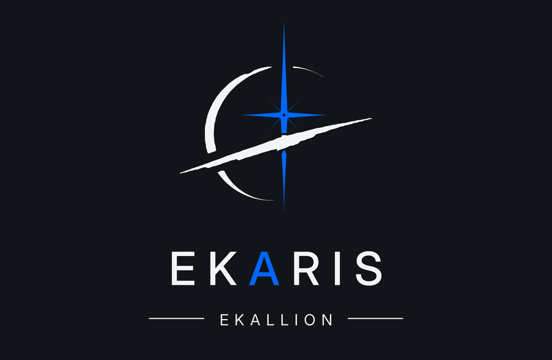

  

<em>Same mind, different worlds.</em>

# Ekaris

**A personal AI control plane and second brain.**

Ekaris lets one person describe what they want in plain language and have a team of AI agents carry it out — with memory that does not fade, results that come with evidence, and the human always in control of what matters.

   
  Control Room prototype

## Focus areas

- **Long-term memory** across tools, models and sessions
- **Coordinating AI agents** on real projects
- **Safety and human approval** for every high-risk action
- **Trading research and automation** (private)

## Status

Private project, in active development since 2026.

---

Built by [Doğan (ekallion)](https://github.com/ekallion). This repository is an overview only; it contains no source code, design details or trading logic.
